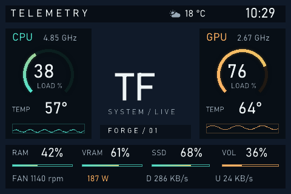

# Telemetry

A fully editable 480×320 screen: cyan CPU and amber GPU dials, temperatures,
frequencies, usage histories, RAM/VRAM/disk/volume indicators, fan speed,
GPU power, network traffic, weather and a clock.

## Import

Download [`telemetry.telemetryforge`](../telemetry.telemetryforge), choose
**Import package** in TelemetryForge, and give the screen a name.
Select the correct display orientation and port for your hardware if needed.

The public sample uses a neutral background and editable TF monogram.
Choose your own background image or slideshow folder to personalize it.
Hide the **Monogram** and **Signature** widgets for an unobstructed wallpaper.
Structural panels are locked to make editing easier; unlock them in Layers
when needed. CPU and GPU components are grouped.

Weather is disabled by default. Configure your location in Setup to enable it.
Missing readings display `--`; preview sensor values are illustrative.

No personal screenshots, credentials, fan bindings, file paths or automation
rules are included. Bahnschrift is referenced as a Windows font family and is
not redistributed. The layout is MIT-licensed with the rest of the project.
